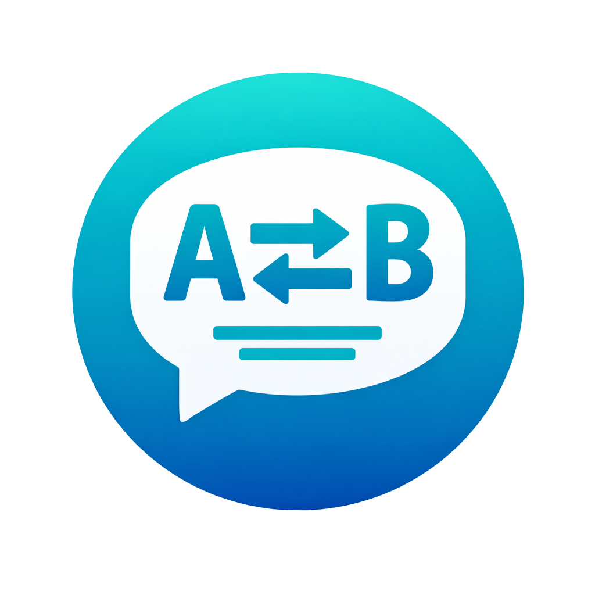
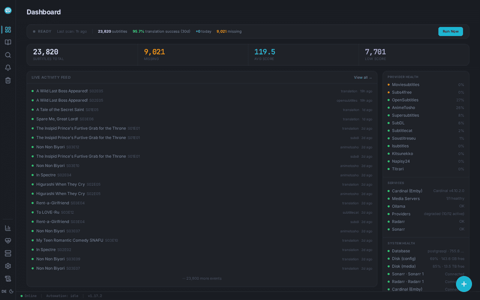
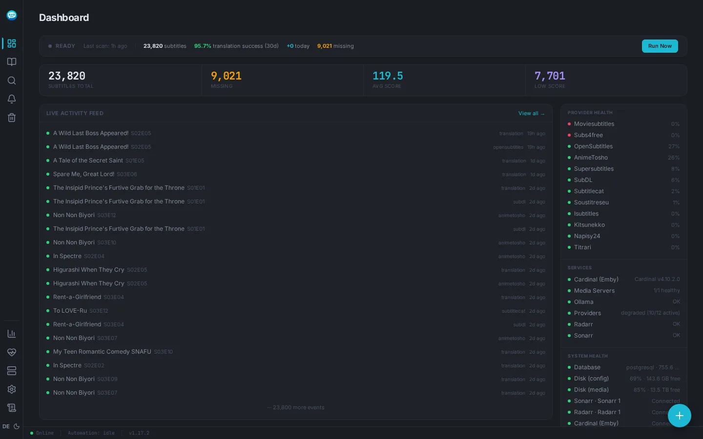
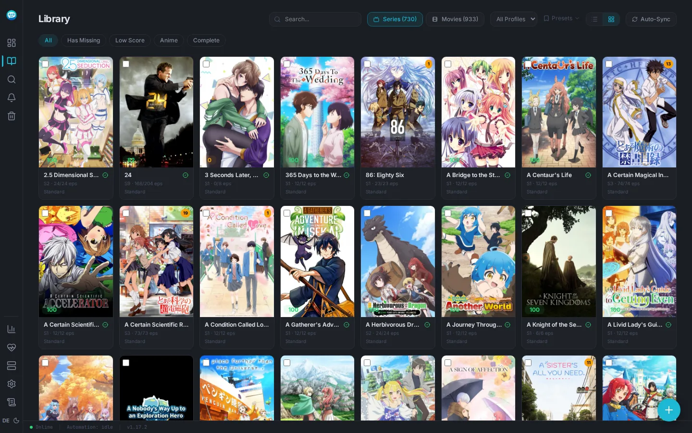
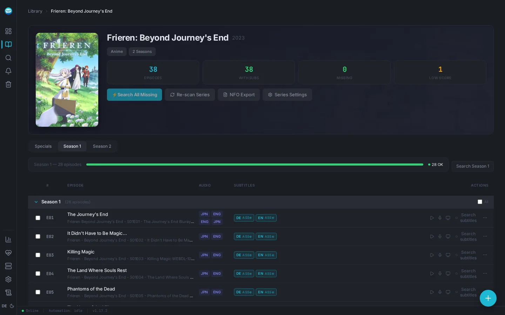
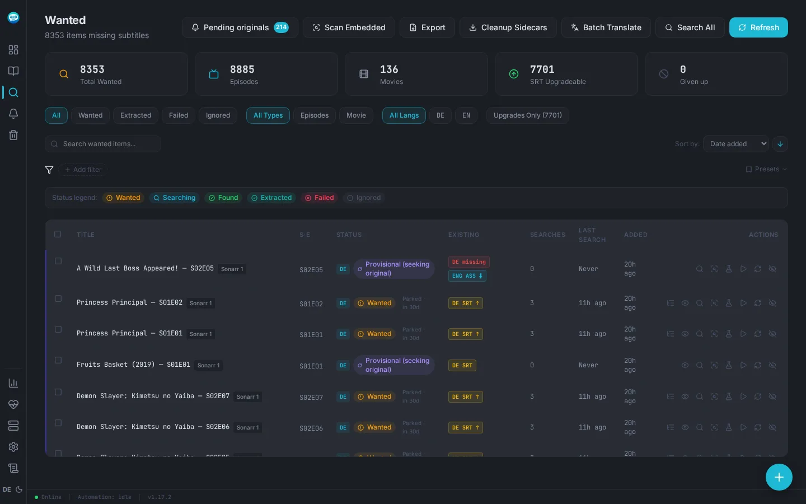

<div align="center">

# Sublarr



### Subtitle Manager & Downloader for Anime and Media

*arr-compatible · Self-hosted · Open Source · Anime-first scoring

[](https://github.com/Abrechen2/sublarr/releases/latest)
[](https://github.com/Abrechen2/sublarr/actions/workflows/ci.yml)
[](#-security)
[](LICENSE)
[](https://www.python.org/)
[](https://react.dev/)
[](https://github.com/Abrechen2/sublarr/pkgs/container/sublarr)

---

**[Quick Start](#-quick-start)** · **[Is it for you?](#-is-sublarr-for-you)** · **[Configuration](#️-configuration)** · **[Limitations](#️-known-limitations)** · **[Integrations](#-integrations)** · **[Website](https://sublarr.de)** · **[Docs](https://sublarr.de/docs/)**

**Community:** [Discord](https://discord.gg/WjatsKzHXz) · [Reddit r/Sublarr](https://www.reddit.com/r/Sublarr/) · [GitHub Issues](https://github.com/Abrechen2/sublarr/issues)

</div>

---

Sublarr is a self-hosted subtitle manager for anime and media libraries. It searches subtitle providers, scores the results (ASS-first), downloads the best match and gives you tools to edit, sync and convert subtitles — all on your LAN.

Connect it to Sonarr/Radarr and it reacts to imports via webhooks, or run it standalone: it watches your media folders and reads `.nfo` metadata, no *arr required.

What sets it apart:

- **Right-episode check and repair** — every search result whose name states a different season or episode is dropped before scoring, for every provider. Subtitles saved earlier for the wrong episode can be found and re-searched under *Settings → System → Subtitle repair*.
- **Encoding repair** — subtitles delivered in legacy encodings (Windows-125x, Greek, Cyrillic, GBK, …) are read in their language's encoding and saved as UTF-8; files damaged by older builds can be restored provably from the original.
- **Anime-aware matching** — AniDB absolute episode order, optional Shoko Server mapping, anime season-collapse handling, ASS/signs track handling and dubtitle detection.

<p align="center">
  
</p>

---

## 🚀 Quick Start

Create a `docker-compose.yml`:

```yaml
services:
  sublarr:
    image: ghcr.io/abrechen2/sublarr:latest
    container_name: sublarr
    ports:
      - "5765:5765"
    volumes:
      - ./config:/config        # database, backups, logs
      - /path/to/media:/media   # your media library (same path your media server sees)
    environment:
      - PUID=1000
      - PGID=1000
    restart: unless-stopped
```

```bash
docker compose up -d
```

Open **http://localhost:5765**. The onboarding wizard walks you through languages, providers and automation. Next step: [First 10 minutes](https://sublarr.de/docs/getting-started/first-10-minutes/).

- **Unraid:** search for **Sublarr** in Community Applications (template: [unraid/README.md](unraid/README.md)).
- **PUID / PGID:** the container starts as root, remaps its `sublarr` user to `PUID`/`PGID`, makes `/config` owned by that user, then drops privileges with `gosu` and runs the app as `PUID:PGID`. `/media` is left untouched — its permissions must already allow that user to read and write. Use `id $USER` on the host to find the right IDs (Unraid uses `99`/`100`).
- More setups (PostgreSQL, Redis, reverse proxy, resource limits): [Installation](https://sublarr.de/docs/getting-started/installation/).

---

## 🤔 Is Sublarr for you?

**Probably not, if** your library is English-only live-action and [Bazarr](https://github.com/morpheus65535/bazarr) already covers it, you never touch anime, or you need multi-user accounts today.

**Probably yes, if** you run anime (absolute ordering, signs/songs tracks, several English tracks per file), care about the subtitle *format* (styled ASS rather than a flattened SRT), maintain several languages with per-language rules, or want to see *why* a file was chosen and change the answer.

More: [Scope and limitations](https://sublarr.de/docs/getting-started/scope-and-limitations/) · [Migrating from Bazarr](https://sublarr.de/docs/getting-started/migrating-from-bazarr/).

---

## ✨ Features

### 🔍 Search & download
- **28 built-in provider adapters** — 20 subtitle sites (AnimeTosho, Jimaku, OpenSubtitles, SubDL, SubSource, Subf2m, SubsDump, Addic7ed, BetaSeries, Titlovi, Titrari, TVSubtitles, Gestdown, Kitsunekko, Napisy24, Podnapisi, YIFY, Zimuku, LegendasDivX, TurkceAltyazi), a Custom HTTP/JSON adapter ([docs/CUSTOM_PROVIDER_API.md](docs/CUSTOM_PROVIDER_API.md)), embedded-track extraction and 6 Subliminal-based alternates
- **43 opt-in catalog providers** — a reviewed, pinned copy of the Bazarr+ provider catalog, off by default
- **ASS-first scoring** with format, release, sync and uploader-trust components; score breakdown on hover; [decision log](https://sublarr.de/docs/user-guide/decision-log/) per search
- **Language profiles** — per-series/film target languages, mustContain / mustNotContain filters, cutoff, audioExclude
- Parallel provider search, per-provider circuit breakers and rate-limit budgets, SHA-256 deduplication, machine-translation flagging

### 📺 *arr & media servers
- Sonarr & Radarr webhooks, multiple instances, tag-based profile assignment, path mapping for remote hosts
- Library refresh for Jellyfin, Emby, Plex and Kodi; Shoko Server for authoritative AniDB matching
- Standalone mode: filesystem watching, `.nfo` metadata, extras skipping, symlink support

### 🔧 Subtitle tools
- [Subtitle editor](https://sublarr.de/docs/user-guide/subtitle-editor/) (CodeMirror, diff view) and [waveform editor](https://sublarr.de/docs/user-guide/waveform-editor/) for retiming
- Sync with ffsubsync / alass, format conversion (ASS, SRT, VTT, SSA), [post-processing pipeline](https://sublarr.de/docs/user-guide/post-processing/) (HI removal, OCR cleanup, formatting fixes)
- OCR for PGS/VobSub tracks (Tesseract), Whisper transcription when no text subtitle exists, embedded-stream removal without re-encoding
- [Subtitle health](https://sublarr.de/docs/user-guide/subtitle-health/) checks and [subtitle repair](https://sublarr.de/docs/user-guide/subtitle-repair/)

### 🖥️ Wanted & automation
- Wanted scanner, event-driven by default (webhooks, manual triggers, file watcher), with an optional periodic fallback
- Upgrade system that replaces low-quality subtitles when a better one appears; batch search with live progress
- [Scheduler admin](https://sublarr.de/docs/user-guide/settings/scheduler/) under *Settings → System → Scheduler* (run now, pause, resume, edit trigger)

### 🌐 Translation
Off by default. Turn it on in *Settings → Translation* and configure a backend: Ollama, DeepL, LibreTranslate, any OpenAI-compatible endpoint, Google Cloud Translation, Claude, Gemini, DeepSeek, Mistral, ChatGPT, Azure Translator or MyMemory. The result depends on the translation backend and model you choose — use at your own risk. See [Translation](https://sublarr.de/docs/user-guide/translation-llm/).

---

## 🖥️ UI Overview

| Dashboard | Library |
|---|---|
|  |  |
| **Series detail** | **Wanted** |
|  |  |

| Page | Description |
|---|---|
| **Dashboard** | Customizable widget grid — status, queue, recent activity, automation status |
| **Library** | Series and movies with subtitle progress and bulk actions |
| **Wanted** | Missing subtitles with one-click search, failure reasons and retry countdown |
| **Activity** | Tabs for live queue, history and blacklist (`/queue` and `/history` redirect here) |
| **Statistics** | Provider success rates, language distribution, quality trends |
| **Providers** | Per-provider statistics — success rates, response times, circuit-breaker and throttle state, API budget |
| **Health** | Library problems — series with missing subtitles, stuck wanted items, provider health |
| **Trash** | Deleted subtitle sidecars and video backups, restorable |
| **Logs** | Application log viewer |
| **Settings** | General, Connections, Subtitles, Providers (incl. plugin marketplace — `/plugins` redirects here), Automation, Translation, Notifications, System |

Global search with `Ctrl+K`, keyboard shortcuts (`?`), real-time updates via WebSocket.

---

## ⚙️ Configuration

Almost everything — providers and API keys, languages, Sonarr/Radarr/media-server connections, path mapping, automation, translation — is configured in the **Settings UI and stored in the database**. `SUBLARR_*` environment variables for those settings are ignored (Sublarr logs a warning at startup when it finds one).

Only these bootstrap variables are read from the environment (`backend/config_settings.py` → `BootSettings`):

| Variable | Default | Description |
|---|---|---|
| `SUBLARR_PORT` | `5765` | HTTP port |
| `SUBLARR_API_KEY` | *(empty)* | Optional API key (`X-Api-Key` header); empty = no API-key auth |
| `SUBLARR_CORS_ORIGINS` | `http://localhost:5173,http://localhost:5765` | Allowed CORS / WebSocket origins |
| `SUBLARR_MEDIA_PATH` | `/media` | Media library root inside the container |
| `SUBLARR_CONFIG_DIR` | `/config` | Persistent config directory |
| `SUBLARR_DB_PATH` | `/config/sublarr.db` | SQLite database path |
| `SUBLARR_DATABASE_URL` | *(empty)* | SQLAlchemy URL (e.g. PostgreSQL); wins over `DB_PATH` |
| `SUBLARR_REDIS_URL` | *(empty)* | Optional Redis for cache and queue |
| `SUBLARR_LOG_LEVEL` | `INFO` | `DEBUG`, `INFO`, `WARNING`, `ERROR` |
| `SUBLARR_LOG_FILE` | `/config/sublarr.log` (image) | Log file path |
| `SUBLARR_LOG_FORMAT` | `text` | `text` or `json` |
| `SUBLARR_STATS_ENDPOINT` | `https://stats.sublarr.de/v1/ping` | Opt-in usage statistics target; empty disables sending |
| `SUBLARR_SCHEDULER_ROLE` | `primary` | `disabled` on extra replicas so recurring jobs do not run twice |
| `PUID` / `PGID` | `1000` | User/group the app runs as (see [Quick Start](#-quick-start)) |
| `UMASK` | `022` | umask for files written into `/media` |

Full reference: [Environment variables](https://sublarr.de/docs/getting-started/environment-variables/) · [Settings](https://sublarr.de/docs/user-guide/settings/).

> **Hardlinks:** most Sonarr/Radarr setups hardlink the library to the download folder. A container remux (foreign-track cleanup, signs removal, stream removal) rewrites the file and breaks that hardlink. The default hardlink policy `skip` refuses to remux hardlinked files.

---

## 🔌 Integrations

- **Sonarr & Radarr** — add the connection in *Settings → Connections*, then in Sonarr/Radarr add a webhook (*Settings → Connect → Webhook*) to `http://sublarr:5765/api/v1/webhook/sonarr` (or `/radarr`) for *On Import* and *On Upgrade*.
- **Jellyfin / Emby / Plex / Kodi / Shoko** — add the server in *Settings → Connections*; Sublarr triggers a rescan after each subtitle download. Shoko additionally supplies authoritative AniDB IDs and absolute episode numbers.
- **Standalone** — point Sublarr at your media folders; new video files are added to the wanted list.
- **Remote *arr hosts** — when paths differ between hosts, set a [path mapping](https://sublarr.de/docs/user-guide/path-mapping/) in *Settings → Connections*.

Walkthroughs: [Integrations](https://sublarr.de/docs/user-guide/integrations/) · [AniDB](https://sublarr.de/docs/user-guide/anidb/) · [Reverse proxy](https://sublarr.de/docs/troubleshooting/reverse-proxy/).

---

## ⚠️ Known limitations

- **One shared password, no user accounts.** No usernames, roles or per-user audit trail. For multi-user setups put it behind a reverse proxy with forward-auth; Sublarr can read proxy auth headers (Authelia / authentik).
- **One instance per library.** The scheduler assumes a single primary; extra replicas need `SUBLARR_SCHEDULER_ROLE=disabled`. No worker pool, no multi-host distribution.
- **No auto-update, by design.** The UI tells you when a newer release exists; you run the upgrade. Read the [CHANGELOG](CHANGELOG.md) first.
- **Docker is the supported path.** Running from source is for development; bare-metal installs are not tested.
- **Provider coverage depends on your accounts.** Several providers need credentials or an API key; without them you run a smaller subset.
- **Anime-first defaults.** ASS gets a large scoring bonus over SRT — deliberate for anime, less relevant for English live-action.
- **Solo-maintained.** Bug reports get read; response time varies.
- **Docs can drift.** If [the documentation](https://sublarr.de/docs/) and the running app disagree, trust the app and [open an issue](https://github.com/Abrechen2/sublarr/issues).

Keep backups of your subtitle files before enabling automation.

---

## 🔒 Security

CI runs on every push to `master`.

- **Blocks the build:** `ruff check` + `ruff format --check`, `pip-audit -r requirements.txt` (no ignored advisories), `bandit` at HIGH severity / HIGH confidence ([`backend/.bandit`](backend/.bandit)), `npm audit --omit=dev --audit-level=high`, custom lint gates (`is_safe_path()` argument order, UI-first config, no `routes` imports in `services`), backend and frontend test suites.
- **Reported in the CI job log, non-blocking:** Semgrep, Trivy, bandit findings below the gate, `npm audit` over dev dependencies. Nothing is uploaded to GitHub code scanning.

Report vulnerabilities as described in [SECURITY.md](SECURITY.md).

---

## 💻 Development

```bash
# First-time setup (Python + Node dependencies, optional pre-commit hooks)
npm run setup:sh      # Linux/Mac
npm run setup:ps1     # Windows PowerShell

# Backend (:5765) + frontend (:5173)
npm run dev

# Tests
cd backend && python -m pytest
cd frontend && npm test

# Lint & type check
cd backend && ruff check . && ruff format --check .
cd frontend && npm run lint && npx tsc --noEmit
```

Every instance serves its own API reference at `/api/docs` (Swagger UI) and `/api/v1/openapi.json`. Further reading: [Architecture](https://sublarr.de/docs/development/architecture/) · [API reference](https://sublarr.de/docs/development/api-reference/) · [Plugin development](https://sublarr.de/docs/development/plugin-development/) · [Database schema](https://sublarr.de/docs/development/database-schema/) · [ROADMAP.md](ROADMAP.md).

AI was used as a coding assistant during development (scaffolding, test drafting, refactoring sweeps, documentation drafts); architecture, scoring, provider integrations and release decisions were made and debugged by hand.

---

## 🤝 Contributing

1. **Bug reports** → open a [GitHub Issue](https://github.com/Abrechen2/sublarr/issues) with log output and config
2. **Feature requests** → open a Discussion first so the approach can be agreed
3. **Pull requests** → see [CONTRIBUTING.md](CONTRIBUTING.md) and [Contributing](https://sublarr.de/docs/development/contributing/) for code style, tests and commit format

## 💬 Community

- **Discord** — [discord.gg/WjatsKzHXz](https://discord.gg/WjatsKzHXz) — live chat, install help, release testing
- **Reddit** — [r/Sublarr](https://www.reddit.com/r/Sublarr/) — announcements, showcases, discussions
- **GitHub Issues** — [bug reports & feature requests](https://github.com/Abrechen2/sublarr/issues)

---

## 📄 License

GPL-3.0 — see [LICENSE](LICENSE).

Sublarr is not affiliated with the *arr project or any subtitle provider.

---

<div align="center">

A project by <a href="https://www.abrechen2.de/"><code>&lt;abrechen2 /&gt;</code></a>

<a href="https://www.paypal.com/donate?hosted_button_id=GLXYTD3FV9Y78">
  
</a>

</div>
